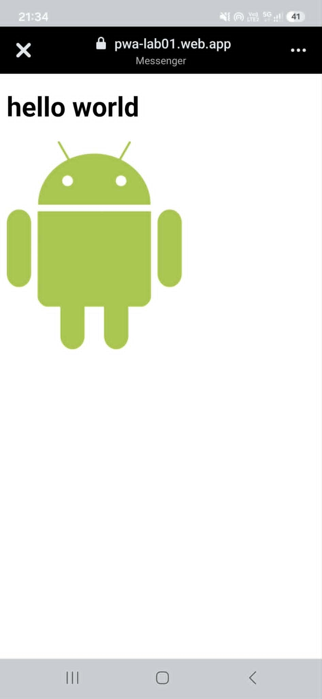

# Lab 01
## Co zostało zrealizowane
Przygotowano aplikację PWA, którą można zainstalować na urządzeniu. W testach Lighthouse aplikacja uzyskała 100 punktów w kategoriach Accessibility i Best Practices.
## Uruchomienie lokalne 
Otwórz terminal w katalogu lab_01/public i uruchom:
npx serve
Następnie otwórz w przeglądarce adres http://localhost:3000.
## Opublikowana aplikacja
Aplikacja jest dostępna pod adresem https://pwa-lab01.web.app.
## Zrzut ekranu aplikacji
