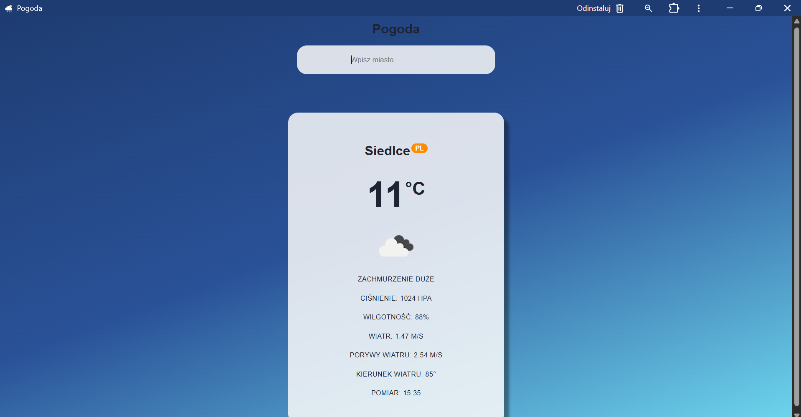
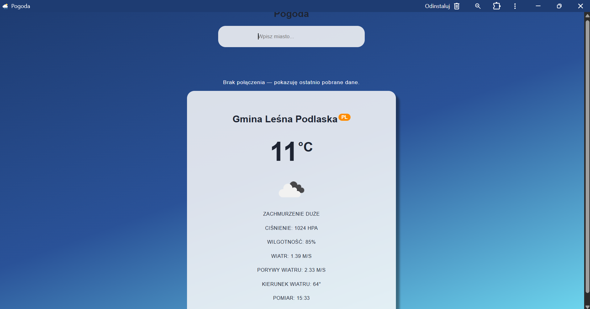
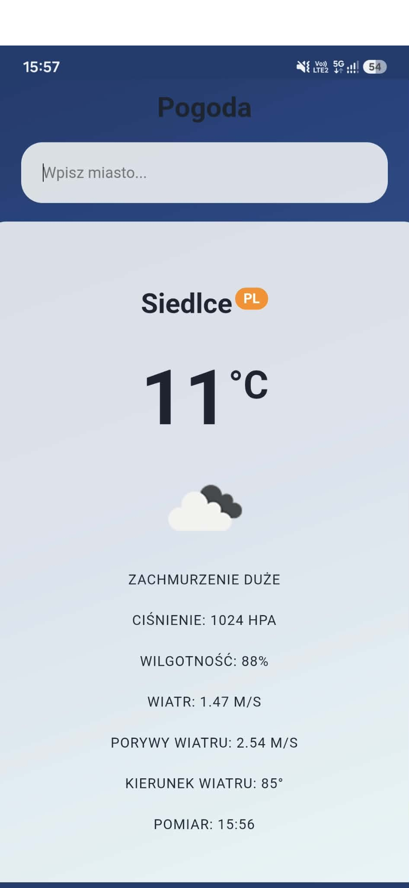
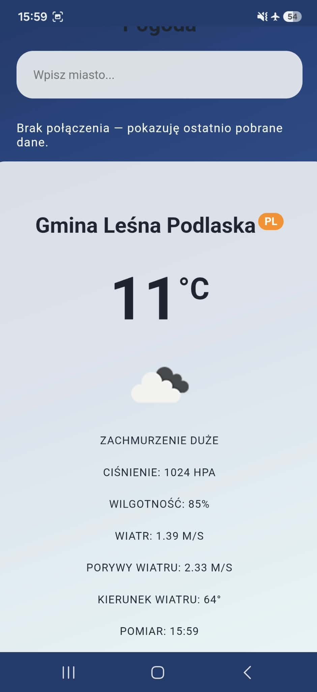

# Lab 03 – Aplikacja pogodowa PWA

## Uruchomienie
1. Wygeneruj projekt React/Vite poleceniem npm create vite@latest . -- --template react.
2. Skopiuj pliki z tego pakietu do odpowiednich miejsc projektu.
3. Zainstaluj zależności: npm install oraz npm install -D vite-plugin-pwa.
4. Wygeneruj ikony: npx @vite-pwa/assets-generator --preset minimal-2023 public/favicon.svg.
5. W pliku src/api/fetchWeather.js wpisz własny klucz OpenWeatherMap w API_KEY.
6. Uruchom tryb pracy: npm run dev.
7. Sprawdź PWA/offline: npm run build, następnie npm run preview.

## Test offline
W trybie preview najpierw wyszukaj miasto przy połączeniu z internetem. Następnie w DevTools → Network wybierz Offline i wyszukaj to samo miasto. Powinny pojawić się ostatnio zapisane dane. Miasto, którego wcześniej nie wyszukiwano, pokaże komunikat o braku połączenia.

## Funkcje
- wyszukiwanie pogody przez OpenWeatherMap,
- walidacja błędów i stan ładowania,
- temperatura, opis, ikona, ciśnienie, wilgotność, wiatr i czas pomiaru,
- komunikat o braku sieci,
- PWA z cache plików aplikacji oraz odpowiedzi API.

# Lab 03 – Aplikacja pogodowa PWA

Aplikacja pokazuje pogodę dla wybranego miasta i działa offline na podstawie wcześniej pobranych danych.

**Aplikacja:** https://lab3-852f8.web.app

## Komputer

## Telefon

