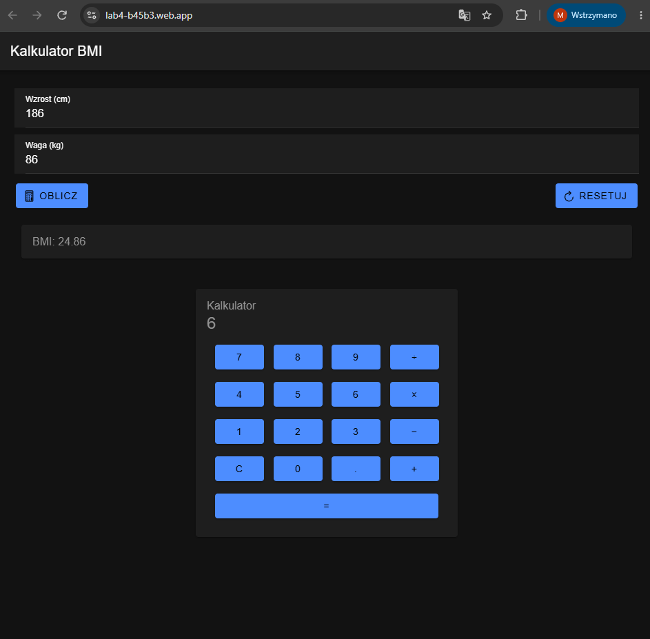
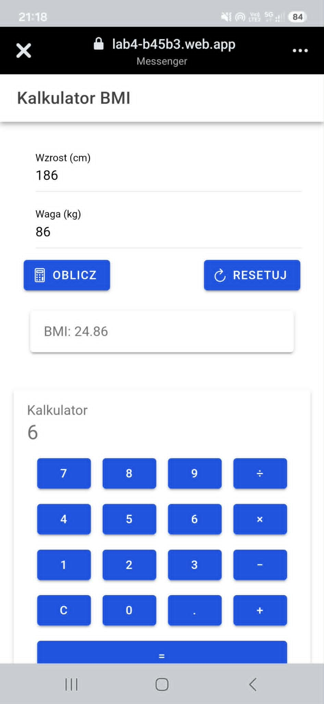

# Lab 04 – Ionic React

## Co zostało wykonane

1. Zbudowałem kalkulator BMI z polami na wzrost i wagę. Przycisk Oblicz liczy BMI, a Resetuj czyści pola.
2. Dodałem wyświetlanie wyniku BMI z dokładnością do dwóch miejsc po przecinku. Wynik znika po naciśnięciu Resetuj.
3. Dodałem osobny kalkulator z przyciskami do dodawania, odejmowania, mnożenia i dzielenia. Przycisk C czyści działanie, a dzielenie przez zero wyświetla komunikat.

## Uruchomienie

W folderze projektu wpisz:

    npm install
    ionic serve

## Aplikacja

https://lab4-b45b3.web.app

## Zrzuty ekranu

Komputer

Telefon
