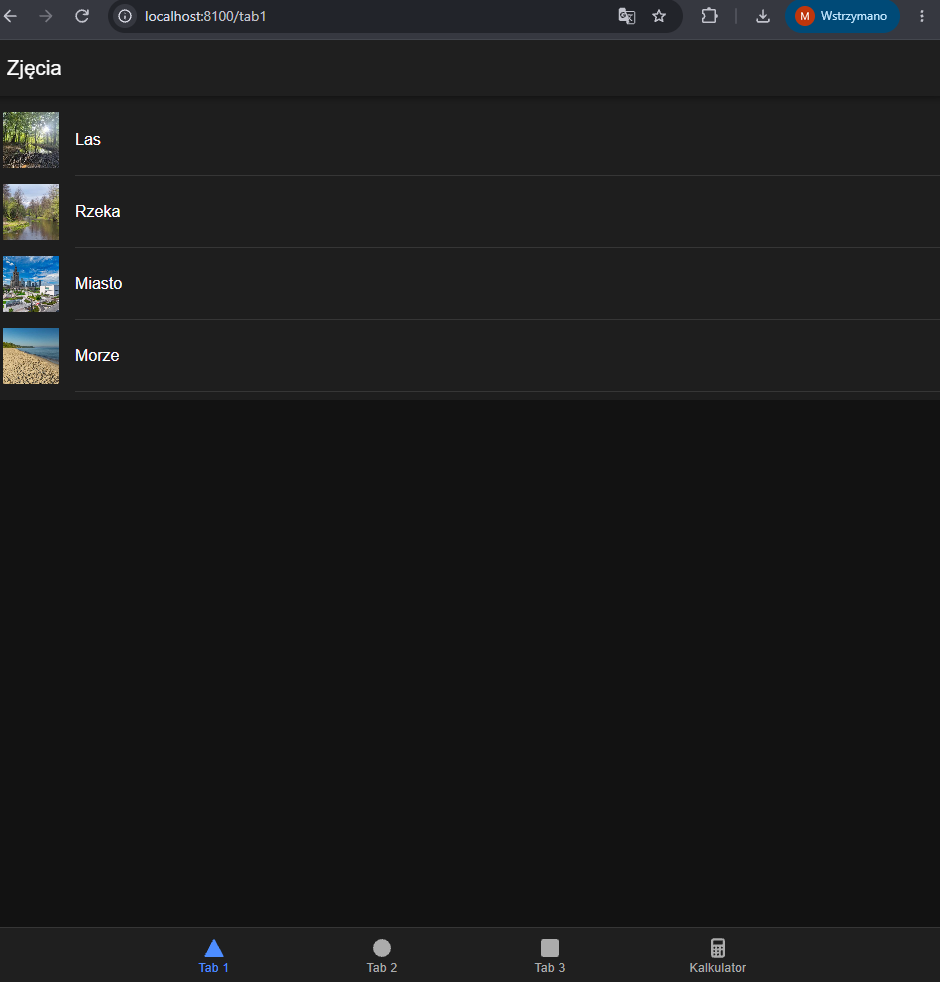
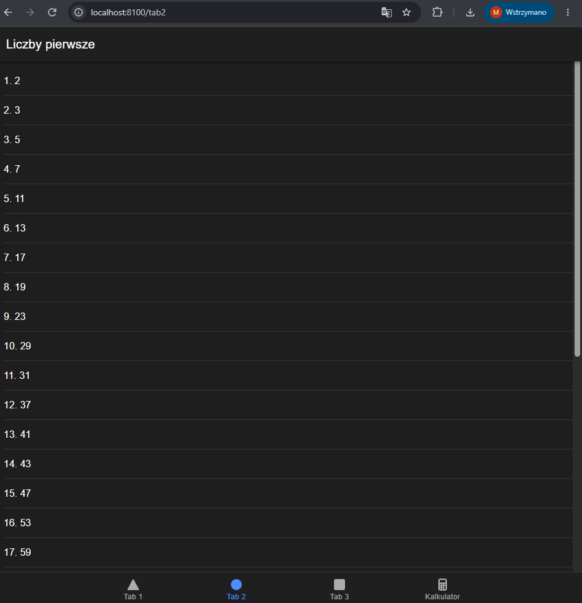
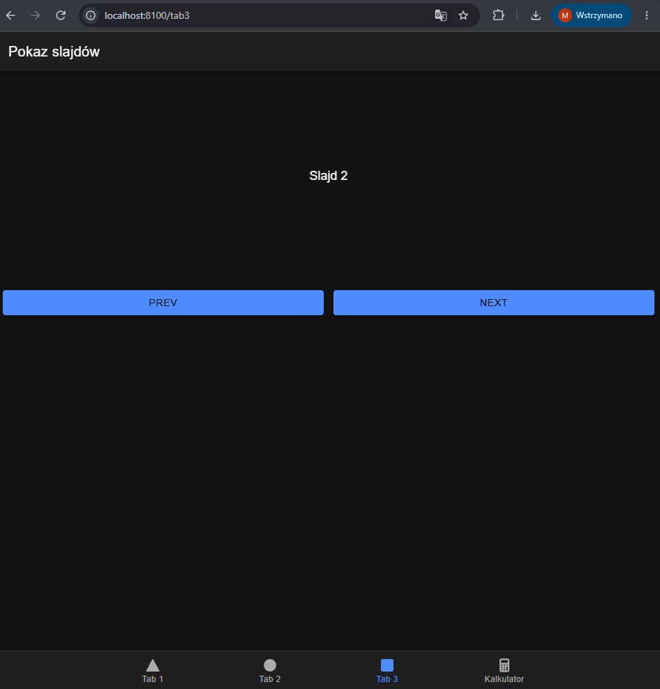
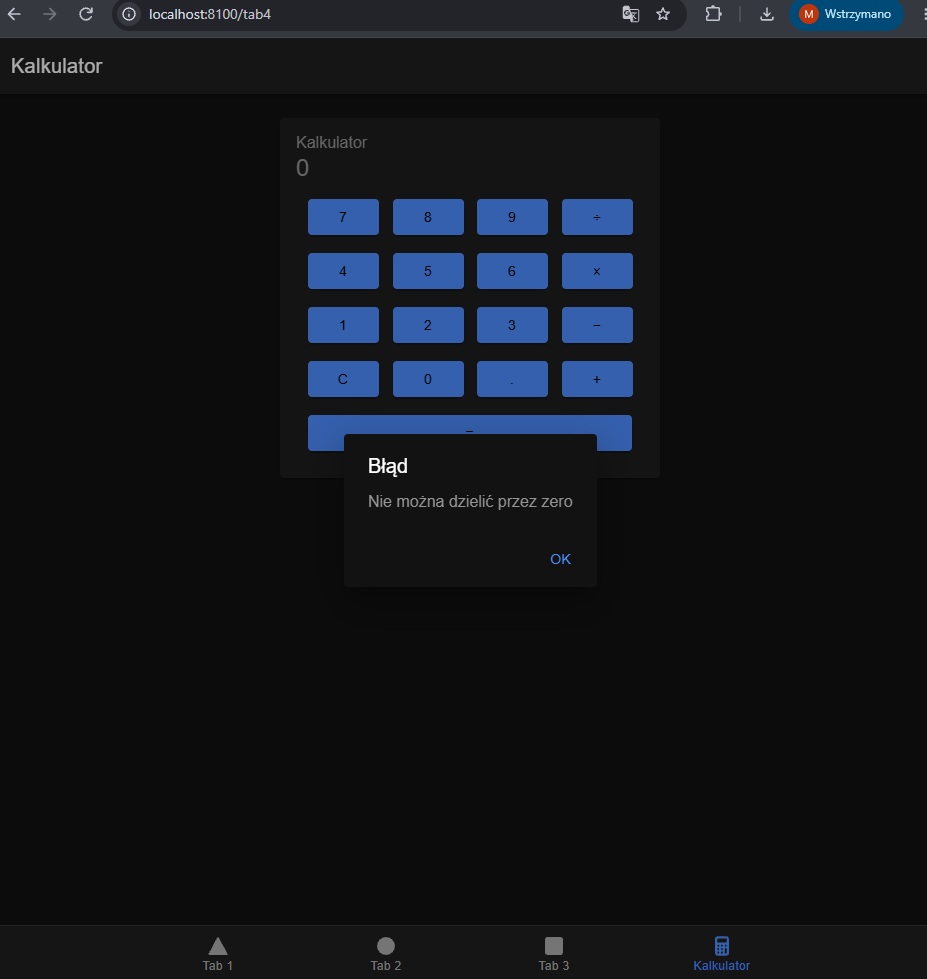

# Lab 5

W projekcie dodałem zakładkę z kalkulatorem. Kalkulator pokazuje alert przy próbie dzielenia przez zero. Na pozostałych zakładkach znajduje się lista zdjęć, lista liczb pierwszych uzupełniana podczas przewijania oraz pokaz slajdów z przyciskami PREV i NEXT.

## Uruchomienie

W terminalu przejdź do folderu `lab_05` i wpisz:

`npm install`

`ionic serve`

Aplikacja otworzy się pod adresem podanym w terminalu, `http://localhost:8100`.

## Zrzuty ekranu

### Lista zdjęć

### Liczby pierwsze

### Pokaz slajdów

### Kalkulator i alert

