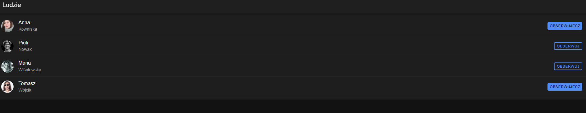
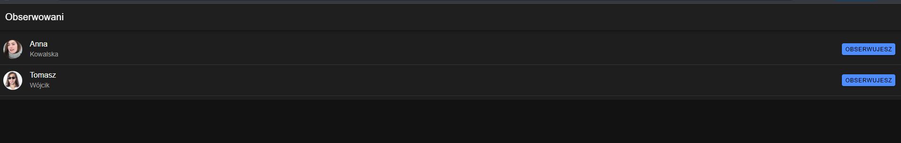
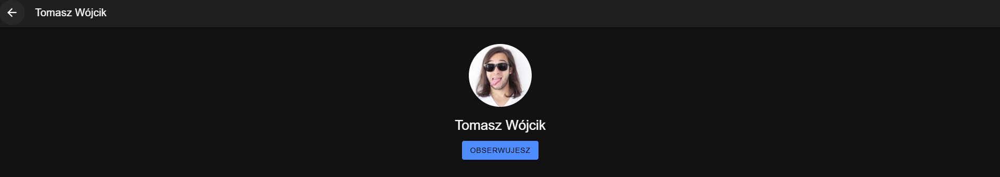
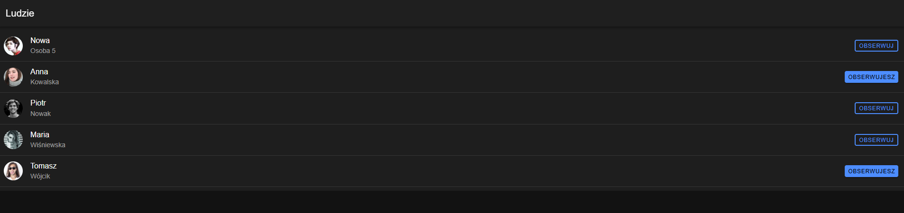
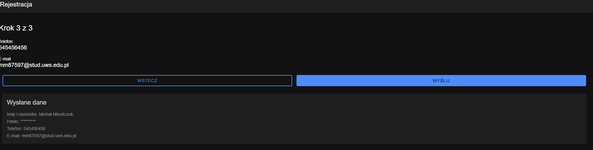

# Lab 6

W aplikacji są trzy zakładki: Ludzie, Obserwowani i Rejestracja. Na liście Ludzie można obserwować osoby, a wybrane osoby pojawiają się w zakładce Obserwowani. Po kliknięciu osoby otwierają się jej szczegóły. Listę można odświeżyć, przeciągając ją w dół.

W zakładce Rejestracja jest formularz podzielony na trzy kroki. Puste lub niepoprawne pola blokują przejście dalej. Po wysłaniu wyświetla się podsumowanie, a hasło jest pokazane jako gwiazdki.

## Uruchomienie

W terminalu otwartym w folderze `lab_06` wpisz:

`npm install`

Potem uruchom:

`ionic serve`

Adres aplikacji pojawi się w terminalu.

## Zrzuty ekranu

